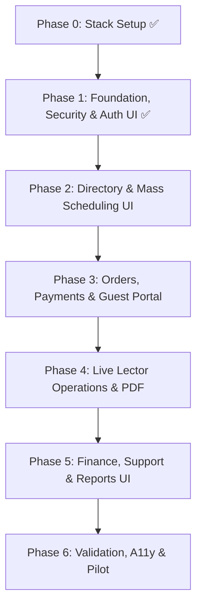

# Pabasa — Development Phase Tracker

> **Project:** Multi-Church Reading-Intention System  
> **Spec:** [`multi_church_reading_system_development_specification.md`](multi_church_reading_system_development_specification.md)  
> **Last updated:** 2026-10-29  

---

## Implementation Phases

---

### Phase 0 — Stack Setup

**Status:** ✅ Completed

> Pre-requisite before any feature work. Not in the spec but required because the project is a fresh Laravel skeleton.

**Deliverables:**

- [x] Install Inertia.js (server adapter + client)
- [x] Install React 19 + @inertiajs/react
- [x] Install Laravel Breeze with Inertia/React variant (auth scaffolding)
- [x] Switch default DB to MySQL 8.4 in `.env.example` and `config/database.php`
- [x] Install Ziggy for named route access in React
- [x] Configure 3 locales: `en`, `fil`, `ceb`
- [x] Set up directory structure per spec §2
- [x] Verify Docker Compose boots cleanly with MySQL 8.4 + Redis 7

**Acceptance:** Project runs with Inertia/React, auth works, MySQL is default.

---

### Phase 1 — Foundation, Security & App Shell UI

**Status:** ✅ Completed  
**Spec section:** §11 Phase 1  

#### 1. Backend Track
- [x] Migrations: `users`, `churches`, `church_memberships`, `invitations`, `system_settings`, `audit_logs`
- [x] Backed PHP enums: `UserStatus`, `ChurchStatus`, `MembershipRole`, `MembershipStatus`
- [x] Policies: `ChurchPolicy`, `MembershipPolicy`, `AuditLogPolicy`
- [x] Auth backend: registration, login/logout, email verification, session management
- [x] Invitation acceptance, revocation, staff deactivation + session invalidation
- [x] Audit service (`app/Services/Audit/`)
- [x] Baseline rate limits (login, invite acceptance, recovery)
- [x] Factories: Central Admin, Church Admin, Lector, registered user, two churches

#### 2. UI/UX Track (Inertia + React 19)
- [x] **Design System & Primitives:** Reverent church aesthetic tokens (warm gold, deep purple/slate, ivory), typography scale, base button, input, card, badge, modal, and table primitives in `resources/js/Components/`
- [x] **Auth Screens Theming:** Adapt Breeze Login, Register, Forgot Password, and Profile pages to Pabasa branding with responsive layout and locale switcher (`en`, `fil`, `ceb`)
- [x] **Staff Invitation Acceptance View:** Token verification screen with password creation, clear expiration warnings, and invalid/revoked token feedback
- [x] **Church Membership Management UI:** Staff roster table with role badges (Church Admin vs Lector), invite staff modal, and instant deactivation modal with confirmation prompt
- [x] **Central Admin & Church Admin Layout Shells:** Persistent navigation shells, breadcrumbs, user dropdown, tenant indicator, and flash message toasts

#### 3. Wiring & Integration
- [x] Wire staff invitation forms to backend actions with optimistic feedback and validation error display
- [x] Wire membership management actions (invite, deactivate, change role) to backend policies and audit logger
- [x] Implement loading skeletons, empty states, and permission-denied (403/404) views

**Test cases (16):**

- [x] 1. Unauthenticated visitor cannot access staff dashboards
- [x] 2. Registered user can register/login/logout; logout invalidates session
- [x] 3. Unverified user cannot access secure order tracking
- [x] 4. Expired invitation cannot be accepted
- [x] 5. Revoked invitation cannot be accepted
- [x] 6. Invitation token is stored hashed and is one-time use
- [x] 7. Church Admin can access own church membership list but not another church's
- [x] 8. Lector membership does not grant Church Admin permissions
- [x] 9. Revoked/deactivated membership immediately blocks subsequent requests
- [x] 10. Central Admin privilege is checked server-side
- [x] 11. Sensitive role/membership changes create audit entries with actor, target, reason, timestamp
- [x] 12. Passwords, raw invitation tokens, and secrets never appear in audit logs
- [x] 13. Rate limiting applies to login, invite acceptance, and recovery endpoints
- [x] 14. Locale switching does not mutate stored user-entered text
- [x] 15. Foreign keys and indexes migrate cleanly on MySQL 8.4
- [x] 16. Backup restoration procedure can restore the Phase 1 database into an isolated environment

**Release gate:** Automated authorization tests pass; no cross-church access path remains untested; UI shells and membership screens render cleanly with error handling.

---

### Phase 2 — Church Directory & Mass Scheduling UI

**Status:** ⬜ Not started  
**Spec section:** §11 Phase 2  

#### 1. Backend Track
- [ ] Migrations: `church_branding`, `church_categories`, `mass_series`, `mass_schedules`, `mass_assignments`
- [ ] Backed PHP enums: `BookingStatus`, `MassStatus`
- [ ] Policy: `MassSchedulePolicy`
- [ ] Church verification / publication / suspension workflow
- [ ] Categories management (church-defined, deactivate not delete)
- [ ] Mass schedules: recurring series/occurrences, booking windows, cutoffs
- [ ] Lector assignments
- [ ] Conflict detection (shared resources/staff, not blanket overlap rejection)

#### 2. UI/UX Track (Inertia + React 19)
- [ ] **Public Church Directory:** Search bar, diocese/city filters, parish cards with cover photo/logo, published status badges, and church profile page
- [ ] **Public Mass Schedule View:** Calendar and list views of upcoming Masses, language tags, chapel locations, booking status badges, and live cutoff countdown indicators
- [ ] **Church Admin Schedule Builder:** Recurring schedule generator, single-occurrence exception editor, cutoff and booking window selectors, and resource conflict alerts
- [ ] **Intention Categories Manager:** Custom category creation table, color tags, activation toggle, and deactivation warning modal
- [ ] **Lector Assignment Matrix:** Visual schedule board assigning verified lectors to Masses with conflict detection warnings

#### 3. Wiring & Integration
- [ ] Wire public church directory search and filtering to backend queries with debounced URL query params
- [ ] Wire schedule builder form to backend recurring series actions with frontend date-range validation
- [ ] Ensure non-published churches return 404 on public routes and render graceful not-found states

**Test cases (18):**

- [ ] 1. Draft/unverified/suspended/deactivated churches do not accept public submissions
- [ ] 2. Only published churches appear in the public directory
- [ ] 3. Central Admin can verify and publish a church; action is audited
- [ ] 4. Church Admin cannot edit another church's profile or branding
- [ ] 5. Church Admin can create/edit own church Masses
- [ ] 6. Editing one occurrence does not silently alter other recurring occurrences
- [ ] 7. Invalid or past booking windows are rejected
- [ ] 8. Closed Mass remains visible but cannot be selected for submission
- [ ] 9. New order creation is rejected after cutoff
- [ ] 10. Assigned lector can close submissions early
- [ ] 11. Lector cannot extend the cutoff beyond authorized limits
- [ ] 12. Conflict detection considers configured shared resources/staff and allows unrelated chapel overlaps
- [ ] 13. Lector cannot view unassigned Mass details by changing the URL ID
- [ ] 14. Suspending a church blocks new orders but preserves existing orders/payments
- [ ] 15. Mass cancellation creates a case and preserves original schedule data
- [ ] 16. Schedule updates and staff assignments create audit events
- [ ] 17. Church timezone is used consistently in displayed cutoff and schedule times
- [ ] 18. Concurrent requests around cutoff cannot both bypass the cutoff rule

**Release gate:** Booking rules pass boundary-time and concurrent-request tests; public directory and schedule builder render responsively on mobile and desktop.

---

### Phase 3 — Orders, Payments, Guest Tracking & Review Queue

**Status:** ⬜ Not started  
**Spec section:** §11 Phase 3  

#### 1. Backend Track
- [ ] Migrations: `pricing_configurations`, `orders`, `intentions`, `payments`, `payment_evidence`, `payment_exceptions`, `refunds`, `correction_requests`, `cancellation_requests`, `rescheduling_requests`, `guest_order_access`, `order_account_links`
- [ ] Backed PHP enums: `OrderStatus`, `IntentionStatus`, `PaymentStatus`, `RefundStatus`, `CancellationRequestStatus`, `ReschedulingRequestStatus`, `CorrectionRequestStatus`
- [ ] Policies: `OrderPolicy`, `PaymentPolicy`, `RefundPolicy`
- [ ] Domain action: `CreateOrder` (spec §8.1)
- [ ] Domain action: `SubmitPaymentEvidence` (spec §8.2)
- [ ] Domain action: `VerifyPayment` — Central Admin only (spec §8.3)
- [ ] Pricing configuration guardrails and order snapshots
- [ ] Protected evidence uploads (private disk, randomized keys, authorized streaming)
- [ ] Guest access: secure tracking, email verification, recovery, credential revocation

#### 2. UI/UX Track (Inertia + React 19)
- [ ] **Parishioner Intention Booking Wizard:**
  - Step 1: Mass selection with date and cutoff indicators
  - Step 2: Multi-intention builder (category selection, intention wording, donor name, duplicate warning banner)
  - Step 3: Transparent pricing breakdown and order summary
  - Step 4: GCash payment screen (church GCash QR code, account number, drag-and-drop screenshot uploader with client image preview and file validation)
- [ ] **Guest Order Tracking Portal:** Mobile-first order tracking page displaying live order timeline (`awaiting_payment` → `payment_under_review` → `confirmed` → `completed`), email challenge entry modal, and receipt download
- [ ] **Central Admin Payment Review Queue:** Split-screen review workbench:
  - Left panel: Order details, claimed amount, reference number, duplicate reference warning flags, exception history
  - Right panel: High-resolution zoomable GCash screenshot viewer
  - Action bar: Explicit human verification buttons: "Verify Payment", "Flag Review Exception" (underpaid/overpaid/unclear), "Reject with Reason"
- [ ] **Correction & Cancellation Modals:** Parishioner-facing request dialogs to submit spelling fixes or cancellation requests before cutoff

#### 3. Wiring & Integration
- [ ] Wire multi-step booking wizard to `CreateOrder` and `SubmitPaymentEvidence` with form state persistence and validation feedback
- [ ] Wire Central Admin verification workbench to `VerifyPayment` with row locking and instant UI feedback
- [ ] Connect guest access token validation and email challenges with rate limiting indicators

**Test cases (30):**

- [ ] 1. Registered user creates an order with multiple intentions for one Mass
- [ ] 2. Guest can submit without an account and receives a secure tracking flow
- [ ] 3. An order containing intentions for different churches or Masses is rejected
- [ ] 4. Inactive category is rejected for new submissions; historical label snapshot unchanged
- [ ] 5. Names and wording preserve exact submitted Unicode text
- [ ] 6. Duplicate-warning logic flags likely duplicates but does not block a legitimate repeat
- [ ] 7. No approved pricing config → `configuration_required`; no price invented
- [ ] 8. Order and all intention rows roll back if any child creation fails
- [ ] 9. Mass closing between page load and submit → server-side rejection
- [ ] 10. Payment evidence accepts only allowed, validated file types; rejects oversized/malicious
- [ ] 11. Evidence storage is private; cannot be fetched without authorization
- [ ] 12. Evidence submission moves payment to pending_verification but NEVER verified
- [ ] 13. Church Admin cannot verify/reject payment by direct POST
- [ ] 14. Lector cannot access payment evidence
- [ ] 15. Central Admin can verify only after explicit action with verified amount/reference
- [ ] 16. Duplicate reference creates a review flag; same transaction cannot be counted twice
- [ ] 17. Underpayment, overpayment, unclear evidence, unmatched ref, late payment → review/resolution flow
- [ ] 18. Rejection requires a reason and produces user-facing notice
- [ ] 19. Retried verification request does not duplicate reading-list entries
- [ ] 20. Guest tracking rejects order number alone
- [ ] 21. Guest tracking requires valid credential + verification + unexpired access
- [ ] 22. Recovery response does not disclose whether an email exists
- [ ] 23. Replacing a guest credential invalidates the old credential
- [ ] 24. Matching email alone cannot link a guest order to a registered account
- [ ] 25. Owner can edit eligible intentions before payment verification; blocked after
- [ ] 26. Cancellation request does not automatically cancel/refund the order
- [ ] 27. Rescheduling request does not automatically move an order
- [ ] 28. Every sensitive payment/order decision creates an audit record
- [ ] 29. Concurrent Central Admin verification → one consistent decision
- [ ] 30. Payment after cutoff held for review rather than silently discarded

**Release gate:** All payment exception tests pass; payment evidence remains strictly private; verification queue and parishioner booking wizard tested across mobile and desktop.

---

### Phase 4 — Reading Operations & Live Lector UI

**Status:** ⬜ Not started  
**Spec section:** §11 Phase 4  

#### 1. Backend Track
- [ ] Migrations: `reading_lists`, `reading_list_entries`, `reading_list_versions`
- [ ] Backed PHP enums: `ReadingListStatus`, `ReadingEntryStatus`
- [ ] Policy: `ReadingListPolicy`
- [ ] Domain action: `ReorderReadingList` (spec §8.4)
- [ ] Domain action: `ApplyCorrection` (spec §8.5)
- [ ] Immutable snapshotting on finalization; reopening and refinalization workflows
- [ ] Protected PDF reading list generator
- [ ] Read-only offline caching & stale-data indicator

#### 2. UI/UX Track (Inertia + React 19)
- [ ] **Live Lector Dashboard (Tablet & Mobile Optimized):**
  - High-contrast, glare-resistant ambo reading mode (dark/light toggle with elevated contrast)
  - Resizable large typography slider for effortless reading while speaking
  - Drag-and-drop / handle reordering during preparation phase
  - Intention pronunciation assistance: phonetic guide chips and emphasis notes
  - Single-tap completion checkmark with progressive visual strike-through
- [ ] **Reading List Finalization Workflow UI:** Warning modal explaining list freeze, version indicator, "Reopen List with Justification" modal, and change-log history drawer
- [ ] **PDF / Print Layout:** Formatted, print-ready intention sheet matching ecclesiastical standards with church header, Mass details, category sections, and date stamps
- [ ] **Offline Stale Warning Banner:** Prominent indicator when network connection is severed, showing last sync time and disabling unsafe live mutations

#### 3. Wiring & Integration
- [ ] Wire live intention completion to backend actions with optimistic UI updates and auto-retry on reconnection
- [ ] Wire reorder actions to `ReorderReadingList` with debounce and rollback on failure
- [ ] Secure PDF download stream verifying lector assignment server-side

**Test cases (22):**

- [ ] 1. Reading list contains only eligible confirmed intentions
- [ ] 2. Unverified order never occupies a confirmed reading-list slot
- [ ] 3. Lector sees only assigned Masses and only authorized fields
- [ ] 4. Reordering persists the exact requested order
- [ ] 5. Duplicate, missing, or foreign entry IDs rejected during reorder
- [ ] 6. Reordering a finalized list is rejected
- [ ] 7. Finalization creates an immutable snapshot/version and audit event
- [ ] 8. Reopening requires permission and reason; it creates history
- [ ] 9. Re-finalization creates a new version without deleting the prior snapshot
- [ ] 10. Correction request does not change wording before approval
- [ ] 11. Approved correction preserves original wording and records reviewer/reason
- [ ] 12. Correction to a finalized list requires reopen/correct/re-finalize path
- [ ] 13. Completion records actor and timestamp
- [ ] 14. Completion correction requires a reason and preserves original event history
- [ ] 15. One entry can be completed independently of other entries
- [ ] 16. Whole-list completion blocked while required conditions unmet
- [ ] 17. Protected PDF denied to unassigned lector and unauthorized user
- [ ] 18. Cached list displays last sync time and stale/offline indicator
- [ ] 19. Offline mode disables reordering, completion, and schedule changes
- [ ] 20. Revoked access clears/invalidates cached private data
- [ ] 21. Scheduled finalization retry does not create duplicate versions or corrupt state
- [ ] 22. Issue reports expose user-safe status but not internal staff notes

**Release gate:** List finalization, reopening, live completion, and offline warning pass rigorous device and network tests.

---

### Phase 5 — Finance, Support, Reporting & Admin Portals

**Status:** ⬜ Not started  
**Spec section:** §11 Phase 5  

#### 1. Backend Track
- [ ] Migrations: `settlements`, `settlement_lines`, `payouts`, `support_tickets`, `support_ticket_events`, `notification_deliveries`, `privacy_requests`, `security_incidents`
- [ ] Backed PHP enums: `SettlementStatus`, `PayoutStatus`, `SupportTicketStatus`, `SupportTicketPriority`, `SupportTicketCategory`
- [ ] Policies: `SettlementPolicy`, `PayoutPolicy`, `SupportTicketPolicy`, `PrivacyRequestPolicy`, `SecurityIncidentPolicy`
- [ ] Settlement calculator service (spec §6.2): `PricingService` / `SettlementCalculator`
- [ ] Domain actions: `RecordRefundTransfer`, `RecordPayoutTransfer` (spec §8.6)
- [ ] PDF/CSV/XLSX export generators with formula injection sanitization
- [ ] Support ticket routing and event logs
- [ ] Privacy request erasure & export pipelines

#### 2. UI/UX Track (Inertia + React 19)
- [ ] **Central Admin Settlement Console:** Settlement calculation breakdown, line-item verification audits, church payout approval modal with manual bank transfer reference recorder
- [ ] **Church Admin Financial Dashboard:** Remittance summaries, verified intention volume charts, payout history timeline, and downloadable bank receipt attachments
- [ ] **Support Ticket Desk:**
  - Categorized ticket inbox (Payment/Refund, Church, Technical, Urgent Triage)
  - Conversation thread view with internal staff notes visually distinguished (yellow/amber badge) from public user messages
  - Quick action toolbar: assign, elevate priority, attach order link, close ticket
- [ ] **Secure Export & Reports UI:** Date range, church, and category filter modals, sanitized CSV/XLSX/PDF generation status, and expiring download links
- [ ] **Privacy Request Management Portal:** User data request intake screen, identity verification challenge, and data export download page

#### 3. Wiring & Integration
- [ ] Wire settlement calculations with validation guardrails preventing approval of unconfigured business rules
- [ ] Wire support tickets with role-based routing and ensure internal notes are never sent in customer-facing props
- [ ] Integrate secure file downloads with expiring signed URLs

**Test cases (28):**

- [ ] 1. Settlement includes only verified payments
- [ ] 2. Pending, rejected, and review-required payments excluded
- [ ] 3. A payment cannot be included twice in active settlements
- [ ] 4. Missing approved revenue-sharing config → `configuration_required`
- [ ] 5. No fixed price, fee, or percentage is seeded or assumed
- [ ] 6. Calculation uses versioned approved config and stores reproducible snapshot
- [ ] 7. Changing a config does not alter past order or settlement snapshots
- [ ] 8. Settlement approval blocked until review prerequisites met
- [ ] 9. Church Admin sees only their church settlement summary
- [ ] 10. Lector cannot access financial reports
- [ ] 11. Creating a refund request does not mark it approved or completed
- [ ] 12. Refund approval does not mark money returned
- [ ] 13. Refund completion requires actual transfer details and authorized confirmation
- [ ] 14. Payout preparation does not mark payout completed
- [ ] 15. Payout completion requires actual transfer details and authorized confirmation
- [ ] 16. Support ticket routing: payment/refund → Central Admin
- [ ] 17. Church-specific tickets → relevant Church Admin
- [ ] 18. Technical tickets → designated technical support
- [ ] 19. Urgent/unclassified → Central Admin triage
- [ ] 20. Internal notes never appear in user-facing ticket views or exports
- [ ] 21. Notification failure does not reverse a payment or reading state
- [ ] 22. Notification retries do not create duplicate state transitions
- [ ] 23. Export is scoped to the requesting user's permissions
- [ ] 24. CSV/XLSX export mitigates formula injection
- [ ] 25. Private export files require authorization and expire per config
- [ ] 26. Privacy request cannot be fulfilled before identity verification
- [ ] 27. Retention/deletion job disabled until approved retention settings exist
- [ ] 28. Sensitive exports and financial actions are audited

**Release gate:** Settlement calculations verified; refund/payout recording requires explicit transfer proof; support desks and financial summaries render correctly.

---

### Phase 6 — System Validation, A11y & Pilot Launch

**Status:** ⬜ Not started  
**Spec section:** §11 Phase 6  

#### 1. Technical & Security Validation Track
- [ ] Full automated test suite passing on production-compatible MySQL 8.4
- [ ] Cross-tenant IDOR penetration sweep across all controllers and policies
- [ ] Rate limit and brute-force testing on auth, guest recovery, and evidence upload endpoints
- [ ] Transaction rollback and concurrent race verification
- [ ] Disaster recovery: database restore and relation reconciliation drill
- [ ] Laravel Cloud deployment configuration validation

#### 2. UI/UX Accessibility, Responsiveness & Design Polish
- [ ] **Accessibility (WCAG 2.1 AA Audit):** Keyboard navigation, visible focus rings, color contrast ratios (≥4.5:1), aria-live regions for dynamic status updates
- [ ] **Responsive Device Testing:**
  - Mobile phone testing for parishioner booking and guest tracking
  - Tablet testing (portrait & landscape) for the Live Lector Reading dashboard
  - Desktop testing for Central Admin split-screen verification queue and settlement console
- [ ] **Localization Completeness:** 100% UI translation coverage across English (`en`), Filipino (`fil`), and Cebuano (`ceb`), ensuring submitted intention text is preserved verbatim
- [ ] **Empty, Loading & Error States:** Unified design for skeleton loaders, empty directory states, and human-friendly validation alerts

#### 3. Pilot Deployment Track
- [ ] Pilot onboarding of 2–3 initial parishes
- [ ] Centralized GCash reconciliation runbook validation with operations staff
- [ ] Final sign-off on legal privacy notices and revenue-sharing parameters

**Test cases (18):**

- [ ] 1. Run full automated suite against production-compatible MySQL version
- [ ] 2. Cross-church IDOR tests: orders, intentions, schedules, assignments, evidence, PDFs, support, reports, settlements, exports
- [ ] 3. Simultaneous order submissions at cutoff
- [ ] 4. Concurrent payment verification and duplicate references
- [ ] 5. Payment upload interruption and safe retry behavior
- [ ] 6. Transaction rollback for order creation, verification, reorder, settlement, refund/payout
- [ ] 7. Queue retries, failed jobs, and notification recovery
- [ ] 8. Database backup restore and order/payment relationship reconciliation
- [ ] 9. Private storage objects remain private after deployment
- [ ] 10. Session invalidation after staff deactivation and password/security recovery
- [ ] 11. Rate limits and generic recovery responses
- [ ] 12. Keyboard navigation, focus, labels, validation errors, status announcements, contrast, mobile layouts
- [ ] 13. en/fil/ceb UI switching without translating saved intention content
- [ ] 14. PWA installability and offline stale-list handling
- [ ] 15. Logs do not contain passwords, raw guest tokens, or unnecessary private data
- [ ] 16. No real payment/refund/payout represented as completed without explicit human recording
- [ ] 17. Pilot with limited verified churches and staff
- [ ] 18. Documented support routing, payment reconciliation, Mass cancellation, settlement procedures confirmed

**Release gate:** All automated tests pass; accessibility and cross-device audits complete; pilot operational runbooks verified.

---

## Risks & Edge Cases

| # | Risk | Severity | Mitigation | Status |
|---|---|---|---|---|
| 1 | **Church isolation bypass** — cross-tenant data leak via URL ID manipulation | 🔴 Critical | Composite FK where possible; all queries scoped from membership, not request input; IDOR test suite for every resource | ⬜ |
| 2 | **Double-counted payment** — same GCash transaction included in multiple settlements | 🔴 Critical | Unique constraints on `settlement_lines(settlement_id, payment_id)`; `lockForUpdate()` during verification; transactional checks | ⬜ |
| 3 | **Invented pricing** — system fabricates prices/fees/percentages | 🔴 Critical | No seeded values; `configuration_required` status blocks settlement calculation; documented in AGENTS.md | ⬜ |
| 4 | **Float money arithmetic** — rounding errors in financial calculations | 🔴 Critical | `DECIMAL(12,2)` in all migrations; `bcmath` for PHP math; linting/review enforcement | ⬜ |
| 5 | **Concurrent cutoff bypass** — two requests racing past Mass cutoff time | 🟠 High | Recheck cutoff inside transaction with row lock on `mass_schedules` | ⬜ |
| 6 | **Guest token leak** — raw tokens logged or exposed in URLs | 🟠 High | Hash-only storage; never log raw tokens; rate-limit recovery routes; minimize URL params | ⬜ |
| 7 | **Payment evidence exposure** — screenshots publicly accessible | 🟠 High | Private disk storage; randomized keys; authorized controller streaming only; never expose `storage_key` | ⬜ |
| 8 | **Finalized list corruption** — silent edits to finalized reading list | 🟠 High | Immutable version snapshots; reopen requires audit trail + reason; re-finalization creates new version | ⬜ |
| 9 | **SQLite in tests** — tests pass on SQLite but fail on MySQL production | 🟡 Medium | Spec explicitly forbids SQLite-only testing; enforce MySQL in CI/CD and local testing | ⬜ |
| 10 | **No Inertia/React installed** — stack gap blocks UI work | 🟡 Medium | Phase 0 prerequisite; must complete before any feature phase | ✅ |
| 11 | **Concurrent verification race** — two admins verifying same payment simultaneously | 🟠 High | `lockForUpdate()` + state recheck inside transaction; second request fails gracefully | ⬜ |
| 12 | **Auto-complete anti-pattern** — timers or scheduled jobs completing refunds/payouts | 🔴 Critical | Spec explicitly forbids auto-completion; all completions require human confirmation + transfer evidence | ⬜ |

---

## Progress Summary

| Phase | Focus | Backend | UI/UX | Tests | Status |
|---|---|---|---|---|---|
| Phase 0 | Stack Setup | 8 items | Integrated | — | ✅ Completed |
| Phase 1 | Foundation & Security | 8 items | 5 UI items | 16 cases | ✅ Completed |
| Phase 2 | Directory & Mass Scheduling | 8 items | 5 UI items | 18 cases | ⬜ Not started |
| Phase 3 | Orders, Payments & Guest Portal | 9 items | 4 UI items | 30 cases | ⬜ Not started |
| Phase 4 | Reading Operations & Live Lector UI | 7 items | 4 UI items | 22 cases | ⬜ Not started |
| Phase 5 | Finance, Support & Reports | 8 items | 5 UI items | 28 cases | ⬜ Not started |
| Phase 6 | System Validation & Pilot | 6 items | 4 UI items | 18 cases | ⬜ Not started |
| **Total** | **Full-Stack Platform** | **54 items** | **27 UI items** | **132 cases** | — |
