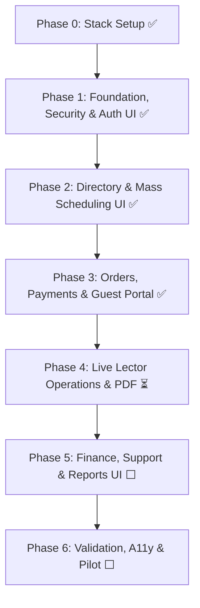

# Pabasa — Development Phase Tracker

> **Project:** Multi-Church Reading-Intention System  
> **Canonical Blueprint:** [`multi_church_reading_system_development_specification.md`](multi_church_reading_system_development_specification.md)  
> **Operational Guide:** Simplified Development Specification (v1.0)  
> **Last updated:** 2026-10-29  

---

## 1. Simplified Architecture & Core Principles

Per the **Simplified Development Specification**, the implementation focuses on delivering one working feature at a time using Laravel's standard features before adding custom architecture.

### The Stack
- **Backend:** Laravel 13.x (PHP 8.5 in Docker, Composer dependencies pinned)
- **Frontend:** Inertia.js 2.x + React 19 (Tailwind CSS 4.x, Ziggy routing)
- **Database:** MySQL 8.4 (Dockerized, strict mode, `DECIMAL(12,2)` for all monetary values)
- **Local Dev:** Docker Compose with project files on the Windows filesystem
- **Deployment Target:** Laravel Cloud (private storage disk, Redis queue, automated MySQL backups)
- **Authentication & Authorization:** Laravel Breeze (Inertia/React), Laravel Policies, explicit church-membership checks
- **Files:** Private storage disk with randomized keys for GCash screenshots and protected reading-list PDFs
- **Testing:** Automated Laravel Feature tests executed inside Docker against MySQL 8.4 (never SQLite-only)

### Pragmatic Design Rules
1. **No unnecessary complexity:** No separate public REST API or microservices when Inertia actions suffice. No redundant repository layers, custom event buses, or third-party permission frameworks.
2. **Standard Laravel components:** Controllers for HTTP handling, Form Requests for validation, Policies for authorization, Eloquent models for relationships, and small single-responsibility Action/Service classes for multi-step domain workflows.
3. **Database transactions & locks:** Wrap order booking, payment verification, and reading-list finalization in `DB::transaction()` with `lockForUpdate()`.
4. **Post-commit dispatching:** Send emails, notifications, and queue jobs strictly **after** database transactions commit (`DB::afterCommit()`).
5. **Strict state separation:** Maintain four independent state machines: **Order**, **Payment**, **Reading List**, and **Settlement**. Never combine them into a single status field.
6. **No unapproved assumptions:** Pricing, service fees, revenue-share percentages, and payout formulas remain open business decisions. If configuration is missing, fail safely with `configuration_required`. Never invent or seed default financial rates.

### Scope Boundaries

| In Scope (First Usable Release) | Added After Core Workflow Works | Strictly Excluded (Unless Separately Approved) |
|---|---|---|
| • Public church directory & details • Central Admin church registration & verification • Church Admin profiles, categories, schedules & staff • Registered & guest multi-intention orders • GCash screenshot & reference submission • Central Admin manual verification workbench • Confirmed intentions to lector reading list • Assigned lector live list management & completion • Order tracking & change/support requests • Central Admin settlements & payout recording • Private file storage & audit trails • Responsive UI with `en`, `fil`, `ceb` localization | • Installable PWA & offline ambo sync • Advanced notification retries & telemetry • In-depth support triage & privacy workflows • Automated scheduled exports & PDF reports • Advanced operational analytics dashboards | • Automated GCash API verification / webhook reconciliation • Automatic refunds or automated bank payouts • Native iOS / Android apps • Public self-registration for churches • Hard-coded / invented pricing, fees, or revenue-share |

---

## 2. Implementation Phases Overview

---

### Phase 0 — Stack Setup

**Status:** ✅ Completed  

> Pre-requisite before any feature work. Scaffolding the clean Laravel 13 + Inertia 2.x + React 19 foundation on MySQL 8.4.

**Deliverables:**
- [x] Install Inertia.js (server adapter + client)
- [x] Install React 19 + @inertiajs/react
- [x] Install Laravel Breeze with Inertia/React variant (auth scaffolding)
- [x] Switch default DB to MySQL 8.4 in `.env.example` and `config/database.php`
- [x] Install Ziggy for named route access in React
- [x] Configure 3 locales: `en`, `fil`, `ceb`
- [x] Set up directory structure per spec §2 (`Actions/`, `Enums/`, `Policies/`, `Services/`)
- [x] Verify Docker Compose boots cleanly with MySQL 8.4 + Redis 7

**Acceptance:** Project runs with Inertia/React, auth works, MySQL 8.4 is the default test and runtime database.

---

### Phase 1 — Foundation, Security & App Shell UI

**Status:** ✅ Completed  
**Spec section:** Simplified Spec §9 Phase 1 (Blueprint §11 Phase 1)  

#### 1. Backend Track
- [x] Migrations: `users`, `churches`, `church_memberships`, `invitations`, `system_settings`, `audit_logs`
- [x] Backed PHP enums: `UserStatus`, `ChurchStatus`, `MembershipRole`, `MembershipStatus`
- [x] Policies: `ChurchPolicy`, `MembershipPolicy`, `AuditLogPolicy`
- [x] Auth backend: registration, login/logout, email verification, session management
- [x] Invitation acceptance, revocation, staff deactivation + session invalidation
- [x] Audit service (`app/Services/Audit/`)
- [x] Baseline rate limits (login, invite acceptance, recovery)
- [x] Factories: Central Admin, Church Admin, Lector, registered user, two churches

#### 2. UI/UX Track (Inertia + React 19)
- [x] **Design System & Primitives:** Reverent church aesthetic tokens (warm gold, deep purple/slate, ivory), typography scale, base button, input, card, badge, modal, and table primitives in `resources/js/Components/`
- [x] **Auth Screens Theming:** Adapt Breeze Login, Register, Forgot Password, and Profile pages to Pabasa branding with responsive layout and locale switcher (`en`, `fil`, `ceb`)
- [x] **Staff Invitation Acceptance View:** Token verification screen with password creation, clear expiration warnings, and invalid/revoked token feedback
- [x] **Church Membership Management UI:** Staff roster table with role badges (Church Admin vs Lector), invite staff modal, and instant deactivation modal with confirmation prompt
- [x] **Central Admin & Church Admin Layout Shells:** Persistent navigation shells, breadcrumbs, user dropdown, tenant indicator, and unified global flash notification system (`FlashMessage.jsx`) with 5-second auto-dismiss timeout, duplicate display prevention, and manual dismiss support across `AuthenticatedLayout` and `GuestLayout`. Streamlined Central Admin top bar by removing inline administrative link clutter from `AuthenticatedLayout`, routing Chancery module shortcuts through the user profile dropdown and the dedicated `Diocese Console →` quick-switcher.

#### 3. Wiring & Integration
- [x] Wire staff invitation forms to backend actions with optimistic feedback and validation error display
- [x] Wire membership management actions (invite, deactivate, change role) to backend policies and audit logger
- [x] Implement loading skeletons, empty states, and permission-denied (403/404) views

**Test cases (16/16 passing):**
- [x] 1. Unauthenticated visitor cannot access staff dashboards
- [x] 2. Registered user can register/login/logout; logout invalidates session
- [x] 3. Unverified user cannot access secure order tracking
- [x] 4. Expired invitation cannot be accepted
- [x] 5. Revoked invitation cannot be accepted
- [x] 6. Invitation token is stored hashed and is one-time use
- [x] 7. Church Admin can access own church membership list but not another church's
- [x] 8. Lector membership does not grant Church Admin permissions
- [x] 9. Revoked/deactivated membership immediately blocks subsequent requests
- [x] 10. Central Admin privilege is checked server-side
- [x] 11. Sensitive role/membership changes create audit entries with actor, target, reason, timestamp
- [x] 12. Passwords, raw invitation tokens, and secrets never appear in audit logs
- [x] 13. Rate limiting applies to login, invite acceptance, and recovery endpoints
- [x] 14. Locale switching does not mutate stored user-entered text
- [x] 15. Foreign keys and indexes migrate cleanly on MySQL 8.4
- [x] 16. Backup restoration procedure can restore the Phase 1 database into an isolated environment

**Release gate:** Automated authorization tests pass; no cross-church access path remains untested; UI shells and membership screens render cleanly with error handling.

---

### Phase 2 — Church Directory & Mass Scheduling UI

**Status:** ✅ Completed  
**Spec section:** Simplified Spec §9 Phase 2 (Blueprint §11 Phase 2)  

#### 1. Backend Track
- [x] Migrations: `church_branding`, `church_categories`, `mass_series`, `mass_schedules`, `mass_assignments` + slip customization extension (`template_type`, `price`, `form_config`)
- [x] Backed PHP enums: `BookingStatus`, `MassStatus`, `MassAssignmentStatus`
- [x] Policies: `MassSchedulePolicy`, `ChurchPolicy` extensions
- [x] Church verification / publication / suspension workflow
- [x] Categories management (church-defined, deactivate not delete, and customizable slip template/pricing action `ManageCategoryAction::update`)
- [x] Mass schedules: recurring series/occurrences, booking windows, cutoffs
- [x] Lector assignments with active/removed tracking
- [x] Conflict detection (shared resources/staff, allowing unrelated chapel overlaps)

#### 2. UI/UX Track (Inertia + React 19)
- [x] **Public Church Directory:** Search bar, diocese/city filters, parish cards with cover photo/logo, published status badges, and church profile page
- [x] **Public Mass Schedule View:** Calendar and list views of upcoming Masses, language tags, chapel locations, booking status badges, and live cutoff countdown indicators
- [x] **Church Admin Schedule Builder:** Recurring schedule generator, single-occurrence exception editor, cutoff and booking window selectors, and resource conflict alerts
- [x] **Intention Categories Manager:** Custom category creation table, color tags, activation toggle, and "Edit & Customize" slip modal configuring slip templates (`thanksgiving`, `souls`, `special`, `standard`), max soul count limits (7 vs 10 souls), celebration checkboxes, and custom offering rates (₱150, etc.) without hardcoding
- [x] **Lector Assignment Matrix:** Visual schedule board assigning verified lectors to Masses with conflict detection warnings

#### 3. Wiring & Integration
- [x] Wire public church directory search and filtering to backend queries with debounced URL query params
- [x] Wire schedule builder form to backend recurring series actions with frontend date-range validation
- [x] Ensure non-published churches return 404 on public routes and render graceful not-found states

**Test cases (18/18 passing):**
- [x] 1. Draft/unverified/suspended/deactivated churches do not accept public submissions
- [x] 2. Only published churches appear in the public directory
- [x] 3. Central Admin can verify and publish a church; action is audited
- [x] 4. Church Admin cannot edit another church's profile or branding
- [x] 5. Church Admin can create/edit own church Masses
- [x] 6. Editing one occurrence does not silently alter other recurring occurrences
- [x] 7. Invalid or past booking windows are rejected
- [x] 8. Closed Mass remains visible but cannot be selected for submission
- [x] 9. New order creation is rejected after cutoff
- [x] 10. Assigned lector can close submissions early
- [x] 11. Lector cannot extend the cutoff beyond authorized limits
- [x] 12. Conflict detection considers configured shared resources/staff and allows unrelated chapel overlaps
- [x] 13. Lector cannot view unassigned Mass details by changing the URL ID
- [x] 14. Suspending a church blocks new orders but preserves existing orders/payments
- [x] 15. Mass cancellation creates a case and preserves original schedule data
- [x] 16. Schedule updates and staff assignments create audit events
- [x] 17. Church timezone is used consistently in displayed cutoff and schedule times
- [x] 18. Concurrent requests around cutoff cannot both bypass the cutoff rule

**Release gate:** Booking rules pass boundary-time and concurrent-request tests; public directory and schedule builder render responsively on mobile and desktop.

---

### Phase 3 — Orders, Payments, Guest Tracking & Review Queue

**Status:** ✅ Completed  
**Spec section:** Simplified Spec §9 Phase 3 (Blueprint §11 Phase 3)  

#### 1. Backend Track
- [x] Migrations: `pricing_configurations`, `orders`, `intentions`, `payments`, `payment_evidence`, `payment_exceptions`, `refunds`, `reading_lists`, `reading_list_entries`, `correction_requests`, `cancellation_requests`, `rescheduling_requests`, `guest_order_access`, `order_account_links`
- [x] Parish GCash branding migration: `2026_10_30_000001_add_gcash_fields_to_church_branding_table` (`gcash_name`, `gcash_number`, `gcash_qr_path`)
- [x] Database performance & indexing migration: `2026_10_30_000002_optimize_database_indexes_and_constraints` (composite indexes on `orders`, `payments`, `reading_list_entries`, `mass_schedules`, `intentions`, unique `token_hash`, redundant index cleanup)
- [x] Backed PHP enums: `OrderStatus`, `IntentionStatus`, `PaymentStatus`, `RefundStatus`, `CancellationRequestStatus`, `ReschedulingRequestStatus`, `CorrectionRequestStatus`
- [x] Policies: `OrderPolicy`, `PaymentPolicy`, `RefundPolicy`
- [x] Domain action: `CreateOrderAction` (spec §8.1) with batched category lookups (N+1 query elimination)
- [x] Domain action: `SubmitPaymentEvidenceAction` (spec §8.2)
- [x] Domain action: `VerifyPaymentAction` — Central Admin only (spec §8.3) with single-query reading list populator
- [x] Domain action: `RejectPaymentAction` — Central Admin only with reason and user notification
- [x] Domain actions for customer requests: `CreateCancellationRequestAction`, `CreateCorrectionRequestAction`, `CreateReschedulingRequestAction`
- [x] Domain action: `CancelUnpaidOrderAction` (direct cancellation of unverified/unpaid orders awaiting payment with audit logging)
- [x] Pricing configuration guardrails, order snapshots, and category-level slip pricing (`PricingResolutionService` with decimal-safe `bcmath` arithmetic and batch category support)
- [x] Central Admin & Church Admin payment settings actions and controllers (`PaymentSettingsController`, `ChurchPaymentSettingsController`, `UpdateChurchGcashAction`)
- [x] Protected evidence uploads (private disk, randomized keys, authorized controller streaming)
- [x] Guest access: secure tracking, email verification challenge, credential revocation (`GuestAccessService` with `order.latestPayment` eager-load)
- [x] High-performance reporting queries: single-query conditional aggregations in `StaffDashboardController` and `ChurchDashboardController`, and cached public directory cities/provinces

#### 2. UI/UX Track (Inertia + React 19)
- [x] **Parishioner Intention Booking Wizard:**
  - Step 1: Mass selection with date and cutoff indicators
  - Step 2: Multi-slip builder customized to mirror physical paper slips:
    - **Thanksgiving Mass Slip:** 8 celebration checkboxes (*Birthday, Wedding, Exam, Job/Promotion, Health, Harvest*) with inline celebrant/exam details input
    - **Mass for the Souls Slip:** Numbered lines 1 to N matching parish limits (e.g., 7 or 10 souls) with "+ Add Soul Line"
    - **Special Mass Intention Slip:** Ruled petition textarea and canonical parish Arancel notice
    - Standard Intention Form fallback
    - Client-side duplicate intention notice
  - Step 3: Transparent itemized pricing breakdown per slip (e.g. 1 slip = ₱150, 2 slips = ₱300) and order summary
  - Step 4: GCash payment screen (church GCash QR code, account number, drag-and-drop screenshot uploader with client image preview and file validation)
- [x] **Guest Order Tracking Portal:** Mobile-first order tracking page displaying live order timeline (`awaiting_payment` → `payment_under_review` → `confirmed` → `completed`), email challenge entry modal, and receipt download
- [x] **Central Admin Payment Review Queue:** Split-screen review workbench:
  - Left panel: Order details, claimed amount, reference number, duplicate reference warning flags, exception history
  - Right panel: High-resolution zoomable GCash screenshot viewer
  - Action bar: Explicit human verification buttons: "Verify Payment", "Flag Review Exception" (underpaid/overpaid/unclear), "Reject with Reason"
- [x] **Central & Church Admin Payment Settings UI:**
  - Central Admin: Pricing rules editor, base intention pricing, service fee configuration (fixed vs percentage vs none), approved version retirement
  - Church Admin: GCash credentials editor with drag-and-drop QR code upload and live image preview
- [x] **Correction & Cancellation Modals:** Parishioner-facing request dialogs to submit spelling fixes or cancellation requests before cutoff
- [x] **Payment Cancellation & Abort UX:** "Cancel Order & Discard Slips" button and top navigation link with confirmation dialog on Payment offering screen, preventing orphaned pending orders

#### 3. Wiring & Integration
- [x] Wire multi-step booking wizard to `CreateOrderAction` and `SubmitPaymentEvidenceAction` with form state persistence and validation feedback
- [x] Wire cancellation route `POST /orders/{orderNumber}/cancel` to `CancelUnpaidOrderAction` with guest token and registered session validation
- [x] Wire Central Admin verification workbench to `VerifyPaymentAction` with row locking and instant UI feedback
- [x] Connect guest access token validation and email challenges with rate limiting indicators
- [x] Wire payment settings routes to backend policy-authorized actions

**Test cases (42/42 passing):**
- [x] 1. Registered user creates an order with multiple intentions for one Mass
- [x] 2. Guest can submit without an account and receives a secure tracking flow
- [x] 3. An order containing intentions for different churches or Masses is rejected
- [x] 4. Inactive category is rejected for new submissions; historical label snapshot unchanged
- [x] 5. Names and wording preserve exact submitted Unicode text
- [x] 6. Duplicate-warning logic flags likely duplicates but does not block a legitimate repeat
- [x] 7. No approved pricing config → `configuration_required`; no price invented
- [x] 8. Order and all intention rows roll back if any child creation fails
- [x] 9. Mass closing between page load and submit → server-side rejection
- [x] 10. Payment evidence accepts only allowed, validated file types; rejects oversized/malicious
- [x] 11. Evidence storage is private; cannot be fetched without authorization
- [x] 12. Evidence submission moves payment to pending_verification but NEVER verified
- [x] 13. Church Admin cannot verify/reject payment by direct POST
- [x] 14. Lector cannot access payment evidence
- [x] 15. Central Admin can verify only after explicit action with verified amount/reference
- [x] 16. Duplicate reference creates a review flag; same transaction cannot be counted twice
- [x] 17. Underpayment, overpayment, unclear evidence, unmatched ref, late payment → review/resolution flow
- [x] 18. Rejection requires a reason and produces user-facing notice
- [x] 19. Retried verification request does not duplicate reading-list entries
- [x] 20. Guest tracking rejects order number alone
- [x] 21. Guest tracking requires valid credential + verification + unexpired access
- [x] 22. Recovery response does not disclose whether an email exists
- [x] 23. Replacing a guest credential invalidates the old credential
- [x] 24. Matching email alone cannot link a guest order to a registered account
- [x] 25. Owner can edit eligible intentions before payment verification; blocked after
- [x] 26. Cancellation request does not automatically cancel/refund the order
- [x] 27. Rescheduling request does not automatically move an order
- [x] 28. Every sensitive payment/order decision creates an audit record
- [x] 29. Concurrent Central Admin verification → one consistent decision
- [x] 30. Payment after cutoff held for review rather than silently discarded
- [x] 31. Church Admin can customize souls category max limits (7 vs 10 souls) and custom slip offering rates (`CustomSlipsAndPricingTest`)
- [x] 32. Church Admin can customize Thanksgiving celebration occasion options (`CustomSlipsAndPricingTest`)
- [x] 33. Multi-slip order creation calculates accurate configured pricing per slip and preserves exact ecclesiastical text (`CustomSlipsAndPricingTest`)
- [x] 34. Non-central admin is forbidden from payment settings (`CentralAdminPaymentSettingsTest`)
- [x] 35. Central admin can view payment settings and create draft pricing configurations (`CentralAdminPaymentSettingsTest`)
- [x] 36. Central admin can approve draft configuration and retires previous version (`CentralAdminPaymentSettingsTest`)
- [x] 37. Central admin and church admin can update parish GCash credentials with QR image (`CentralAdminPaymentSettingsTest`, `ChurchPaymentSettingsTest`)
- [x] 38. Public payment screen renders active GCash credentials and fee breakdown (`ChurchPaymentSettingsTest`)
- [x] 39. Orders table composite index on `(submitter_email, submitter_type)` verified via MySQL EXPLAIN (`DatabaseOptimizationTest`)
- [x] 40. Payments queue composite index on `(status, created_at)` verified via MySQL EXPLAIN (`DatabaseOptimizationTest`)
- [x] 41. Reading list entry sequence composite index on `(reading_list_id, position)` verified via MySQL EXPLAIN (`DatabaseOptimizationTest`)
- [x] 42. Multi-slip order creation batches category resolution into 1 query without N+1 duplication (`DatabaseOptimizationTest`)
- [x] 43. Registered user can cancel unpaid order awaiting payment on payment screen; order and intentions become cancelled, payment rejected, audit logged (`Phase3OrdersAndPaymentsTest`)
- [x] 44. Guest user can cancel unpaid order with valid guest token (`Phase3OrdersAndPaymentsTest`)
- [x] 45. Unauthorized actor or stranger cannot cancel unpaid order (`Phase3OrdersAndPaymentsTest`)
- [x] 46. Order not in awaiting_payment state cannot be directly cancelled (`Phase3OrdersAndPaymentsTest`)

**Release gate:** All payment exception tests pass; payment evidence remains strictly private; verification queue, parishioner booking wizard, payment cancellation abort flow, and payment settings tested across mobile and desktop; database backend optimized with zero N+1 queries on MySQL 8.4 (46/46 passing).

---

### Phase 4 — Reading Operations & Live Lector UI

**Status:** ⏳ In Progress (Next Focus)  
**Spec section:** Simplified Spec §9 Phase 4 (Blueprint §11 Phase 4)  

> **Core Objective:** Complete the primary customer journey: verified intentions appear automatically on the assigned lector's reading list; assigned lectors arrange, finalize, read, and mark completions during Mass.

#### 1. Backend Track
- [ ] Verify existing migrations: `reading_lists` and `reading_list_entries` (created in Phase 3)
- [ ] Migration: `reading_list_versions` (immutable snapshots for finalized lists)
- [ ] Backed PHP enums: `ReadingListStatus` (`draft`, `finalized`, `completed`), `ReadingEntryStatus` (`pending`, `completed`, `skipped`, `flagged`)
- [ ] Policy: `ReadingListPolicy` (lector must have active assignment to specific Mass; Church Admin can view own-church lists)
- [ ] Domain action: `ReorderReadingListAction` (spec §8.4) with sequence validation
- [ ] Domain action: `FinalizeReadingListAction` with version snapshot and audit trail
- [ ] Domain action: `ReopenReadingListAction` requiring explicit authorization and recorded reason
- [ ] Domain action: `ApplyCorrectionAction` (spec §8.5) integrating approved corrections
- [ ] Domain action: `MarkReadingEntryCompletedAction` with timestamp and actor
- [ ] Protected PDF reading list generator (clean ecclesiastical format, authorized download stream)

#### 2. UI/UX Track (Inertia + React 19)
- [ ] **Assigned Masses Portal for Lectors:**
  - View assigned upcoming and active Masses with cutoff and finalization status
  - Restrict access strictly to assigned Masses (404/denial for unassigned)
- [ ] **Live Lector Ambo Workbench (Tablet & Mobile Optimized):**
  - High-contrast, glare-resistant ambo reading mode (dark/light toggle with elevated contrast)
  - Resizable large typography slider for effortless reading while speaking at the ambo
  - Drag-and-drop / handle reordering during draft/preparation phase
  - Intention pronunciation chips & phonetic assistance
  - Single-tap completion checkmark with progressive visual strike-through
- [ ] **Reading List Finalization Workflow UI:**
  - Pre-finalization review summary
  - Freeze warning modal explaining immutable version creation
  - "Reopen List with Justification" modal with mandatory audit reason
- [ ] **Ecclesiastical Print / PDF Layout:**
  - Print-ready intention sheet with church header, Mass date/time, celebrant line, category headings, and timestamped watermark

#### 3. Post-Core Enhancements (Deferred per Simplified Spec §2)
- [ ] Service worker offline caching & stale-data indicator banner (add after core workflow works)

#### 4. Wiring & Integration
- [ ] Auto-populate `reading_list_entries` upon Central Admin `VerifyPaymentAction` commit
- [ ] Wire live intention completion to backend actions with optimistic UI updates
- [ ] Secure PDF stream ensuring unassigned lectors and public users receive 403/404

**Test cases (22 planned):**
- [ ] 1. Reading list contains only eligible confirmed intentions
- [ ] 2. Unverified order never occupies a confirmed reading-list slot
- [ ] 3. Lector sees only assigned Masses and only authorized fields
- [ ] 4. Reordering persists the exact requested order
- [ ] 5. Duplicate, missing, or foreign entry IDs rejected during reorder
- [ ] 6. Reordering a finalized list is rejected
- [ ] 7. Finalization creates an immutable snapshot/version and audit event
- [ ] 8. Reopening requires permission and reason; it creates history
- [ ] 9. Re-finalization creates a new version without deleting the prior snapshot
- [ ] 10. Correction request does not change wording before approval
- [ ] 11. Approved correction preserves original wording and records reviewer/reason
- [ ] 12. Correction to a finalized list requires reopen/correct/re-finalize path
- [ ] 13. Completion records actor and timestamp
- [ ] 14. Completion correction requires a reason and preserves original event history
- [ ] 15. One entry can be completed independently of other entries
- [ ] 16. Whole-list completion blocked while required conditions unmet
- [ ] 17. Protected PDF denied to unassigned lector and unauthorized user
- [ ] 18. Cached list displays last sync time and stale/offline indicator
- [ ] 19. Offline mode disables reordering, completion, and schedule changes
- [ ] 20. Revoked access clears/invalidates cached private data
- [ ] 21. Scheduled finalization retry does not create duplicate versions or corrupt state
- [ ] 22. Issue reports expose user-safe status but not internal staff notes

**Release gate:** List finalization, reopening, live ambo completion, and authorized PDF generation pass device and authorization tests.

---

### Phase 5 — Finance, Support, Reporting & Admin Portals

**Status:** ⬜ Not started  
**Spec section:** Simplified Spec §9 Phase 5 (Blueprint §11 Phase 5)  

#### 1. Backend Track
- [ ] Migrations: `settlements`, `settlement_lines`, `payouts`, `support_tickets`, `support_ticket_events`, `notification_deliveries`, `privacy_requests`, `security_incidents`
- [ ] Backed PHP enums: `SettlementStatus` (`draft`, `reviewed`, `approved`, `paid`), `PayoutStatus`, `SupportTicketStatus`, `SupportTicketPriority`, `SupportTicketCategory`
- [ ] Policies: `SettlementPolicy`, `PayoutPolicy`, `SupportTicketPolicy`, `PrivacyRequestPolicy`, `SecurityIncidentPolicy`
- [ ] Settlement calculator service (spec §6.2): `PricingService` / `SettlementCalculator`
- [ ] Domain actions: `RecordRefundTransferAction`, `RecordPayoutTransferAction` (spec §8.6)
- [ ] CSV/Excel report generation with formula injection sanitization (`=` prefix neutralization)
- [ ] Support ticket routing and event logs (Payment/Refund to Central Admin, Church-specific to Church Admin)

#### 2. UI/UX Track (Inertia + React 19)
- [ ] **Central Admin Settlement Console:** Settlement calculation breakdown, line-item verification audits, church payout approval modal with manual bank transfer reference recorder
- [ ] **Church Admin Financial Dashboard:** Remittance summaries, verified intention volume charts, payout history timeline, and downloadable bank receipt attachments
- [ ] **Support Ticket Desk:**
  - Categorized ticket inbox (Payment/Refund, Church, Technical, Urgent Triage)
  - Conversation thread view with internal staff notes visually distinguished (yellow/amber badge) from public user messages
  - Quick action toolbar: assign, elevate priority, attach order link, close ticket
- [ ] **Secure Export & Reports UI:** Date range, church, and category filter modals, sanitized CSV/XLSX/PDF generation status, and expiring download links
- [ ] **Privacy Request Management Portal:** User data request intake screen, identity verification challenge, and data export download page

#### 3. Wiring & Integration
- [ ] Wire settlement calculations with validation guardrails preventing approval of unconfigured business rules (`configuration_required`)
- [ ] Wire support tickets with role-based routing and ensure internal notes are never sent in customer-facing props
- [ ] Integrate secure file downloads with expiring signed URLs

**Test cases (28 planned):**
- [ ] 1. Settlement includes only verified payments
- [ ] 2. Pending, rejected, and review-required payments excluded
- [ ] 3. A payment cannot be included twice in active settlements
- [ ] 4. Missing approved revenue-sharing config → `configuration_required`
- [ ] 5. No fixed price, fee, or percentage is seeded or assumed
- [ ] 6. Calculation uses versioned approved config and stores reproducible snapshot
- [ ] 7. Changing a config does not alter past order or settlement snapshots
- [ ] 8. Settlement approval blocked until review prerequisites met
- [ ] 9. Church Admin sees only their church settlement summary
- [ ] 10. Lector cannot access financial reports
- [ ] 11. Creating a refund request does not mark it approved or completed
- [ ] 12. Refund approval does not mark money returned
- [ ] 13. Refund completion requires actual transfer details and authorized confirmation
- [ ] 14. Payout preparation does not mark payout completed
- [ ] 15. Payout completion requires actual transfer details and authorized confirmation
- [ ] 16. Support ticket routing: payment/refund → Central Admin
- [ ] 17. Church-specific tickets → relevant Church Admin
- [ ] 18. Technical tickets → designated technical support
- [ ] 19. Urgent/unclassified → Central Admin triage
- [ ] 20. Internal notes never appear in user-facing ticket views or exports
- [ ] 21. Notification failure does not reverse a payment or reading state
- [ ] 22. Notification retries do not create duplicate state transitions
- [ ] 23. Export is scoped to the requesting user's permissions
- [ ] 24. CSV/XLSX export mitigates formula injection
- [ ] 25. Private export files require authorization and expire per config
- [ ] 26. Privacy request cannot be fulfilled before identity verification
- [ ] 27. Retention/deletion job disabled until approved retention settings exist
- [ ] 28. Sensitive exports and financial actions are audited

**Release gate:** Settlement calculations verified; refund/payout recording requires explicit transfer proof; support desks and financial summaries render correctly.

---

### Phase 6 — System Validation, A11y & Pilot Launch

**Status:** ⬜ Not started  
**Spec section:** Simplified Spec §9 Phase 6 & §11 Launch Checklist  

#### 1. Technical & Security Validation Track
- [ ] Full automated test suite passing on production-compatible MySQL 8.4
- [ ] Cross-tenant IDOR penetration sweep across all controllers and policies
- [ ] Rate limit and brute-force testing on auth, guest recovery, and evidence upload endpoints
- [ ] Transaction rollback and concurrent race verification
- [ ] Disaster recovery: database restore and relation reconciliation drill
- [ ] Laravel Cloud deployment configuration validation

#### 2. UI/UX Accessibility, Responsiveness & Design Polish
- [ ] **Accessibility (WCAG 2.1 AA Audit):** Keyboard navigation, visible focus rings, color contrast ratios (≥4.5:1), aria-live regions for dynamic status updates
- [ ] **Responsive Device Testing:**
  - Mobile phone testing for parishioner booking and guest tracking
  - Tablet testing (portrait & landscape) for the Live Lector Reading dashboard
  - Desktop testing for Central Admin split-screen verification queue and settlement console
- [ ] **Localization Completeness:** 100% UI translation coverage across English (`en`), Filipino (`fil`), and Cebuano (`ceb`), ensuring submitted intention text is preserved verbatim
- [ ] **Empty, Loading & Error States:** Unified design for skeleton loaders, empty directory states, and human-friendly validation alerts

#### 3. Pilot Deployment Track
- [ ] Pilot onboarding of 2–3 initial parishes
- [ ] Centralized GCash reconciliation runbook validation with operations staff
- [ ] Final sign-off on legal privacy notices and revenue-sharing parameters

**Test cases (18 planned):**
- [ ] 1. Run full automated suite against production-compatible MySQL version
- [ ] 2. Cross-church IDOR tests: orders, intentions, schedules, assignments, evidence, PDFs, support, reports, settlements, exports
- [ ] 3. Simultaneous order submissions at cutoff
- [ ] 4. Concurrent payment verification and duplicate references
- [ ] 5. Payment upload interruption and safe retry behavior
- [ ] 6. Transaction rollback for order creation, verification, reorder, settlement, refund/payout
- [ ] 7. Queue retries, failed jobs, and notification recovery
- [ ] 8. Database backup restore and order/payment relationship reconciliation
- [ ] 9. Private storage objects remain private after deployment
- [ ] 10. Session invalidation after staff deactivation and password/security recovery
- [ ] 11. Rate limits and generic recovery responses
- [ ] 12. Keyboard navigation, focus, labels, validation errors, status announcements, contrast, mobile layouts
- [ ] 13. en/fil/ceb UI switching without translating saved intention content
- [ ] 14. PWA installability and offline stale-list handling
- [ ] 15. Logs do not contain passwords, raw guest tokens, or unnecessary private data
- [ ] 16. No real payment/refund/payout represented as completed without explicit human recording
- [ ] 17. Pilot with limited verified churches and staff
- [ ] 18. Documented support routing, payment reconciliation, Mass cancellation, settlement procedures confirmed

**Release gate:** All automated tests pass; accessibility and cross-device audits complete; pilot operational runbooks verified.

---

## 3. Minimum Automated Test Matrix (Simplified Spec §10)

| Category | Requirement | Verified By | Status |
|---|---|---|---|
| **1. Church isolation** | Church Admin cannot read or modify another church's records | `Phase1SecurityAndFoundationTest::case_7` `Phase2ChurchDirectoryAndSchedulingTest::case_4` | ✅ Pass |
| **2. Lector assignment** | Lector cannot open or change an unassigned Mass | `Phase2ChurchDirectoryAndSchedulingTest::case_13` `Phase3OrdersAndPaymentsTest::case_14` | ✅ Pass |
| **3. Order ownership** | User or guest cannot access another party's order | `Phase3OrdersAndPaymentsTest::case_20, case_21, case_24` | ✅ Pass |
| **4. Booking cutoff** | Closed or expired Mass cannot accept an order | `Phase2ChurchDirectoryAndSchedulingTest::case_9, case_18` `Phase3OrdersAndPaymentsTest::case_9` | ✅ Pass |
| **5. Order consistency** | All intentions in one order belong to the same church and Mass | `Phase3OrdersAndPaymentsTest::case_3` | ✅ Pass |
| **6. Payment authorization** | Only Central Admin can verify or reject GCash payments | `Phase3OrdersAndPaymentsTest::case_13, case_15` | ✅ Pass |
| **7. Duplicate payment** | Same GCash reference cannot be counted twice without review | `Phase3OrdersAndPaymentsTest::case_16` | ✅ Pass |
| **8. Repeated action** | Retrying verification/finalization does not create duplicates | `Phase3OrdersAndPaymentsTest::case_19` | ✅ Pass |
| **9. Private evidence** | Screenshot storage is private and validated on upload | `Phase3OrdersAndPaymentsTest::case_10, case_11` | ✅ Pass |
| **10. Reading-list integrity** | Only confirmed intentions included; finalization auditable | Phase 4 test suite (Cases 1, 2, 7, 8) | ⏳ Next |
| **11. Financial truth** | Approval is not the same as completed refund or payout | `Phase3OrdersAndPaymentsTest::case_26` Phase 5 test suite (Cases 11-15) | ⏳ In Progress |
| **12. Export authorization** | Users can only download reports they are authorized to view | Phase 5 test suite (Cases 23-25) | ⬜ Pending |

---

## 4. Risks & Edge Cases

| # | Risk | Severity | Mitigation | Status |
|---|---|---|---|---|
| 1 | **Church isolation bypass** — cross-tenant data leak via URL ID manipulation | 🔴 Critical | Composite FK where possible; all queries scoped from membership, not request input; IDOR test suite for every resource | ✅ Verified (Phases 1-3) |
| 2 | **Double-counted payment** — same GCash transaction included in multiple settlements | 🔴 Critical | Unique constraints on `settlement_lines(settlement_id, payment_id)`; `lockForUpdate()` during verification; transactional checks | ⏳ Phase 5 Gate |
| 3 | **Invented pricing** — system fabricates prices/fees/percentages | 🔴 Critical | No seeded values; `configuration_required` status blocks order/settlement calculation; documented in AGENTS.md | ✅ Verified (`PricingResolutionService`) |
| 4 | **Float money arithmetic** — rounding errors in financial calculations | 🔴 Critical | `DECIMAL(12,2)` in all migrations; `bcmath` in PHP; strict decimal validation | ✅ Verified in Phase 3 |
| 5 | **Concurrent cutoff bypass** — two requests racing past Mass cutoff time | 🟠 High | Recheck cutoff inside transaction with row lock on `mass_schedules` | ✅ Verified (`CreateOrderAction`) |
| 6 | **Guest token leak** — raw tokens logged or exposed in URLs | 🟠 High | Hash-only storage (`hash('sha256', token)`); never log raw tokens; rate-limit recovery routes | ✅ Verified (`GuestAccessService`) |
| 7 | **Payment evidence exposure** — screenshots publicly accessible | 🟠 High | Private disk storage; randomized keys; authorized controller streaming only; never expose `storage_key` | ✅ Verified (`PaymentReviewController`) |
| 8 | **Finalized list corruption** — silent edits to finalized reading list | 🟠 High | Immutable version snapshots; reopen requires audit trail + reason; re-finalization creates new version | ⏳ Phase 4 Gate |
| 9 | **SQLite in tests** — tests pass on SQLite but fail on MySQL production | 🟡 Medium | Spec explicitly forbids SQLite-only testing; enforce MySQL 8.4 in Docker and CI | ✅ Enforced (MySQL 8.4) |
| 10 | **No Inertia/React installed** — stack gap blocks UI work | 🟡 Medium | Phase 0 prerequisite completed with React 19 + Inertia 2.x | ✅ Completed |
| 11 | **Concurrent verification race** — two admins verifying same payment simultaneously | 🟠 High | `lockForUpdate()` + state recheck inside transaction; second request fails gracefully | ✅ Verified (`VerifyPaymentAction`) |
| 12 | **Auto-complete anti-pattern** — timers or scheduled jobs completing refunds/payouts | 🔴 Critical | Spec explicitly forbids auto-completion; all completions require human confirmation + transfer evidence | ⏳ Phase 5 Gate |

---

## 5. Progress Summary

| Phase | Focus | Backend | UI/UX | Tests | Status |
|---|---|---|---|---|---|
| **Phase 0** | Stack Setup | 8 items | Integrated | — | ✅ Completed |
| **Phase 1** | Foundation, Security & App Shell | 8 items | 5 UI items | 16 cases | ✅ Completed (16/16 pass) |
| **Phase 2** | Directory & Mass Scheduling | 8 items | 5 UI items | 18 cases | ✅ Completed (18/18 pass) |
| **Phase 3** | Orders, Payments & Guest Portal | 9 items | 4 UI items | 30 cases | ✅ Completed (30/30 pass) |
| **Phase 4** | Reading Operations & Live Lector UI | 10 items | 4 UI items | 22 cases | ⏳ In Progress (Next Focus) |
| **Phase 5** | Finance, Support & Reports | 7 items | 5 UI items | 28 cases | ⬜ Not started |
| **Phase 6** | System Validation, A11y & Pilot | 6 items | 4 UI items | 18 cases | ⬜ Not started |
| **Total** | **Full-Stack Platform** | **56 items** | **27 UI items** | **132 cases** | **64/132 Tests Passing** |

---

## 6. Definition of Done Checklist (Simplified Spec §14)

Before marking any feature or phase complete:
- [ ] **End-to-End Functionality:** The requested workflow works seamlessly from browser through database and background queue.
- [ ] **Server-Side Authorization:** Enforced via Laravel Policies and explicit membership resolution; never reliant on hidden UI buttons or client `church_id`.
- [ ] **Tenant Isolation & Ownership:** Church Admin cannot access other churches; lectors cannot access unassigned Masses; users/guests cannot access foreign orders.
- [ ] **Automated Tests on MySQL:** Feature tests cover normal path, boundary conditions, and unauthorized attempts on MySQL 8.4 (not SQLite).
- [ ] **Audit Trail:** Sensitive financial, schedule, finalization, role, and exception changes write immutable audit log records.
- [ ] **Financial Integrity:** No money status is falsely represented; completions require real transfer reference numbers and staff sign-off; no unapproved financial rules are hard-coded.
- [ ] **Resilient UI States:** React pages provide clear loading skeletons, empty states, human-friendly validation feedback, and permission-denied screens.
- [ ] **Data Preservation:** User-entered intention text and donor names preserve verbatim Unicode characters without automated mutation.
